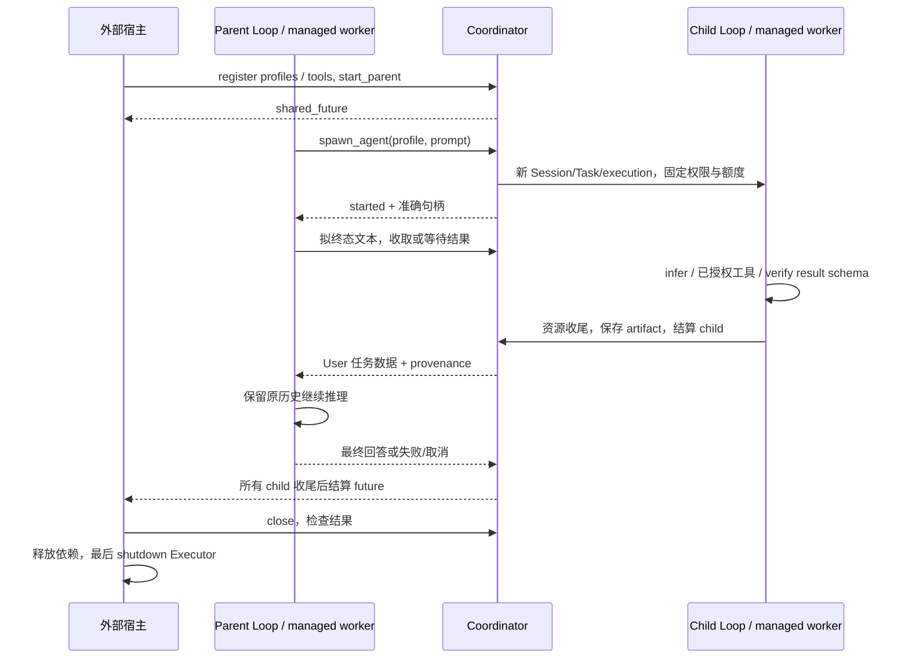

# 受管子代理委派设计

> 状态：Active
> 版本：1.1
> 更新日期：2026-11-09
> 负责人：Mira Maintainers
> 决策：[DEC-099](../decisions/DEC-099-managed-subagent-delegation.md)、[DEC-100](../decisions/DEC-100-subagent-semantic-tools.md)
> 实施：[M34](../plans/m34-managed-subagent-delegation.md)、[M35](../plans/m35-subagent-semantic-tools.md)

## 目标与范围

把已有 child Session/Working Context 基础接成模型可调用的单层推理委派。首期关注
有限任务和结构化结果回流，不引入设备执行面、任意消息树或跨进程重新执行。
外部研究与取舍见[参考研究](subagent-reference-study.md)，公开配置与精确边界见
[子代理 API](../api/subagents.md)。

## 职责与所有权

SubagentCoordinator 属于 Agent Harness，绑定一个 parent AgentLoopSpec。它为 child
生成独立 SessionId/TaskId 与 execution_id，运行既有 ConversationLoop；这些是无观察
Harness 任务身份，不要求伪造 IEnvironment，也不隐式提交 MiraRuntime 设备任务。
已由 MiraRuntime 管理的父任务由宿主在结果结算后按原控制面完成。

宿主拥有 Executor、父 gateway/transport 和存储。coordinator 拥有 parent/child
WorkerHandle、状态记录、累计额度及结果槽，父 loop 转移给受管 worker。每个 child
工厂交付独占 provider 和显式工具/输入依赖；child 内部构造并释放独立 gateway、
router、admission 和预算账本，不并发共享其可变诊断或 Session 绑定。

所有 worker 使用 kairo 的 start_worker，承载模型网络、结果等待及存储收尾。默认
有限任务池不作为阻塞等待层；没有 std::thread/async 或私有定时调度器。worker 只
使用停止探针和有界条件变量等待，超时不强制结束第三方调用。注册保留和多 root
全局容量由 API 明确，不以单 owner 上限声称整个进程无限复用。

## 状态与执行顺序

child 从 Starting 到 Running，再到 Answered/Failed/Cancelled/TimedOut；已终态不
重新运行。停止请求先置协作标记，只有工厂、模型循环和资源析构结束后才发布 done。
Starting 中也可取消，未启动 worker 被拒绝时立即回滚活跃槽并返回明确错误。
execution_id 不复用，查询/取消以完整句柄和 owner 校验，迟到成功不覆盖取消或期限。

parent 只允许 start 一次。接收委派后继续模型工具循环；拟终态而仍有 child 时进入
可观察 Waiting，收到一个或一批结果后继续同一 active run。Waiting 不是 Task 终态。
没有结果且没有活跃 child 时，在锁内封新 spawn，再接受最终回答。父 run 因失败、
限额、取消或 deadline 结束时封准入并取消剩余 child，future 等待实际收尾。

## 输入、权限与资源界限

profile 目录在 tools() 快照时冻结，模型只选已注册名称；描述和 schema enum 说明
角色，不允许模型构造 endpoint、凭据或权限。默认 StaticReadOnly 模式仍使用只读
白名单。[DEC-100](../decisions/DEC-100-subagent-semantic-tools.md)扩展 Discover 模式：
可信 factory 按目标供应目录，child 自行发现、按任务语义选择并动态加载原生 schema，
包括副作用工具。父不枚举工具，目录和工具往返只在子上下文中。模型决定具体选型；
能力范围由目录执行闭包与可选自动执行策略约束，system 文本本身不授予 host 权能。
写操作需要派发前耐久记录与独立 Verify，未知效果停止后续调用并保留对账标志。
共享设备互斥/租约仍由 Adapter/宿主提供，不从子会话身份推导写权限。
详见 [API](../api/subagents.md)与 [M35](../plans/m35-subagent-semantic-tools.md)。

child 启动预占活跃、累计创建、待回流槽和有限轮次资源额度。输入按请求估算核对，
输出按生成上限，失败不退累计额度。账单未知/partial usage 不被重解释为免费。
每个 profile 的模型轮数和 deadline 均有限，父有限轮数也不因结果回流而重置。

新上下文默认只含委派目标和子角色提示。宿主可经既有 ModelInputSupplier 显式供应
M24 基线，但不自动合并 child delta。完整历史 fork、压缩语义和 KV cache 保证不在
此处扩展。可选输出 JSON Schema 在注册和结果完成时分别校验，失败不产生有效答案。

Continuation source 在请求前非阻塞调用，在拟终态时允许协作等待；空结果结束，
错误/异常/容量溢出 fail closed。回流始终是固定来源的 User/Text 数据，不伪装用户
授权或 System 指令。启用时所有 limit mode 都检查历史容量，可回放 thinking 与
call/result 协议保留；不把 provisional 文本提前作为最终对外答案。

## 取消、关闭与错误

单 child cancel 不取消其他 child；root cancel、deadline、Human Takeover 和 close
封新委派并停止本 root。接管恢复由宿主新任务重新观察，不能解除旧 Task 终态。
父模型暂时结束一轮不触发 root cancel；这一区别保证后台结果仍能回流。

外部 close 先广播停止，等待 parent 和 child done，再 join。worker 内自 close 被
拒绝；close 超时返回 DeadlineExceeded 并保留依赖和记录供重试，不能当作释放成功。
关闭后新的模型工具失败，宿主只读 get 仍可检查终态。最终 shutdown 只由外部 owner
调用，不能由 parent/child teardown 代办。

请求错误、工具越权、额度拒绝、提交拒绝、模型/工厂异常、schema 错误和产物失败
均有明确结果。错误不回显原始 callback/provider 异常文本。关键协调事件存储失败
不得默认为成功；事件/claim 失败进入 parent/close 诊断，常规 loop 事件维持其既有
best-effort 语义。

## 事件、复现与兼容

协调事件 schema_version=1，携带 parent Session/Task/execution 和十进制字符串
parent_task_epoch（完整保留 uint64），child 事件带准确 child 句柄。成功答案保存为
Sensitive artifact，事件只有引用、摘要和字节，不复制 prompt/答案。child 模型事件
写在其自身 Session，父协调事件写在 parent Session。

ResultClaimed 记录领取入父历史，不证明后续 infer 已派发或模型已消费。结果和状态
可检查，Replay 不执行任何网络/工具。首期不重新加载已结束 owner、不恢复崩溃时
执行中的 worker或自动重投；不能以事件和 artifact 的耐久性推导执行的恰好一次语义。

公开接口和 ConversationLoop 布局扩展要求重新编译 C++ 消费者。无 continuation source
的现有 loop 行为不变；system 模板复用 DEC-098，不另建子代理私有模型协议。

## 验证策略

真实 parent/child Loop fixture 验证工具往返、等待后继续、独立 Session、产物/来源、
分批完成、结构化结果和显式基线。边界测试覆盖权限、容量、累计额度、默认池被占满
时的进展、创建/执行/停止竞态、自等待拒绝、超时和存储/Executor 失败。
Debug、ASAN/UBSAN、TSAN 与安装消费者证据归 M34；目标平台和真实模型另设补跑条件。
