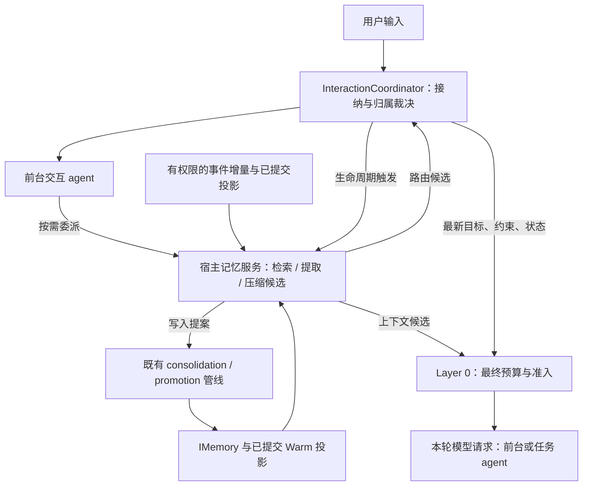

# 记忆代理与长期上下文管理参考研究

> 状态：研究输入（不构成 Accepted 决策、公开 API 或实现承诺）
> 版本：0.1
> 更新日期：2026-11-09
> 负责人：Mira Maintainers
> 工作项：[MNT-202611-MA-01](../plans/maintenance-2026-11-memory-agent-study.md)
> Mira 代码基线：`62ad918`
> 适用范围：M29/M30 立项；M31/M32/M33 的后续接线

后续实施：用户于 2026-11-09 要求采纳并推进开发，具体增量由
[DEC-101](../decisions/DEC-101-memory-agent-context-admission.md)、
[实现设计](memory_agent_design.md)与[M36](../plans/m36-memory-agent-context-integration.md)
承载。下文保留 `62ad918` 的调研时点，不用于覆盖后续实现状态。

## 1. 结论与效力

可以引入独立记忆 agent，负责候选提取、目标导向检索、上下文候选装配和语义压缩。
建议把它实现为**宿主拥有、受 Executor 管理的记忆服务中的有界语义工作单元**。
主 agent 可以按需委派工作；宿主也应在确定的生命周期边界触发维护，不依赖主模型
每次想起调用。用户只需面对一个交互入口，任务执行与记忆整理使用独立上下文。

四种最终权力仍由既有确定性 owner 分别持有：

| 裁决 | owner | 记忆 agent 的输出 |
| --- | --- | --- |
| 输入属于哪个工作、恢复还是新建 | InteractionCoordinator | 有来源的工作候选与路由建议 |
| 什么进入本次请求 | Layer 0 / StandardContextManager | 类型化上下文候选、相关性理由 |
| 什么写入长期记忆 | 既有 consolidation / promotion 提交管线 | 来源可查、验证等级不自提升的提案 |
| 什么可删除、何时行动或提醒 | ACL/policy、存储 owner、M31/M33 | 清理或主动行为建议，不直接产生授权 |

这里的“主 agent 只负责交互”是**模型职责**：它理解用户、提出委派、综合结果并回复。
主 agent 背后的宿主协调层仍负责归属、权限、任务状态、预算和恢复。
单个记忆模型同时掌握上述四权会扩大故障影响，并破坏 DEC-032/068 的边界。

本文区分三种证据：仓库当前代码、外部一手资料陈述、本文提出的 Mira 方案。
方案尚未做真实模型实验；确定性校验能保障边界与来源结构，不能证明模型摘要语义忠实。
本文不新增公共术语；示意中的工作单、版本戳与回执均是待评审方案字段。

## 2. 仓库核查：已有能力与未闭合处

### 2.1 现有约束适合承载记忆代理

- [DEC-032](../decisions/DEC-032-context-intelligence-layered-context.md) 与
  [Context Intelligence 设计](context_intelligence_design.md)：Layer 1–4 只生成候选，
  Layer 0 保留唯一请求期准入；Hot/Warm/Cold 与五元组提交检查可直接复用。
- [DEC-068 §5–§6](../decisions/DEC-068-interaction-coordinator-and-principal-input-entry.md)：
  归属由协调层裁决，模型建议不是裁决；不把最近会话当万能默认，不拼接全部历史。
- [DEC-070](../decisions/DEC-070-long-term-memory-behavior-contract.md)：既有记忆写入路径、
  scope 白名单、纠正/删除及承诺实体的行为设计，是 M30 的直接依据。
  **该文件头仍为 Proposed，而 M30 称其行为契约已冻结**；正式采纳本研究前需由维护者
  对齐决策效力，本文不自行把它改成 Accepted。
- [MemoryConsolidator](../../src/context/memory_consolidation.cpp)、
  [SQLite Memory](../../src/storage/sqlite_memory_store.cpp)、
  [Working Context](context_curator_design.md) 已提供主要存取与投影机制。
  记忆 agent 应编排这些能力，避免建立影子记忆库。

### 2.2 子代理执行基础已经存在，但生命周期不同

[DEC-099/M34](../decisions/DEC-099-managed-subagent-delegation.md) 已有独立 Session/Task、
宿主 profile、受管 worker、有界委派、结果回流、取消与关闭；
[DEC-100/M35](../decisions/DEC-100-subagent-semantic-tools.md) 增加受限工具发现和副作用核验。
交付证据限于各自计划记录的 Linux 范围，不能据此宣称记忆服务已交付。

M34 适用于“查一下过去相关决策”这类**父任务内按需工作**。父 run 终态、失败或取消时
会收拢 child；它不提供跨进程 worker 恢复、无限持续消息或递归团队。因此不能把它
直接当作跨用户任务永久存活的后台记忆 agent。

建议复用 profile、受限工具和 worker 承载方式，分别保持两个 owner：按需任务由父
委派 owner 管，跨任务投影维护由宿主记忆服务 owner 管。不得把已结束的 parent 复活
来接收维护结果，也不得为此创建另一套线程池或调度器。

### 2.3 端到端请求预算仍需明确接线

[ConversationLoop::build_request](../../src/model/conversation_loop.cpp) 直接装配 System、
User envelope 和 history，再经 tool selector 交 gateway；当前该文件没有调用
`IContextManager::prepare`。[HistoryTransformer](../../include/mira/conversation_loop.hpp)
只看工具/会话 replay，看不到完整 system、goal、常驻用户指令、供给 parts 和最终工具 schema。
Continuous 模式会提交有效变换后的 history，失败退回 raw replay，再做容量检查。

所以“已有 Layer 0”不等于“每个 Loop 的最终请求都已受完整 token 准入保护”。尤其
`user_instructions` 在 run 内持续增长，压缩 history 本身不能约束整个 envelope。
必须核验宿主生产接线；建议在可信组装边界对**完整候选请求**执行一次最终准入，覆盖
工具 schema、图像、协议 overhead 与输出预留，并确保准入后不再无审计地追加内容。
若 tool selector 在准入后改变 schema，需要重算或使该变更使先前准入失效。
该改动属于需单独冻结的集成设计，不能声称仅接一个 callback 就已解决。

### 2.4 里程碑按职责拆开

总计划当前将 M28 标为 Completed、M29–M33 标为 Planned；部分旧里程碑前置说明仍称
M28 未关闭，存在文档滞后。M29 是并发归属与恢复前提；长期记忆接线在 M30；
存储容量与遗忘在 M31；安全焦点切换在 M32；自主行为与打断预算在 M33。
“从 M29 开始具备长期自主存在”应视作产品方向，不能等同于 M29 单项完成这些能力。

## 3. 外部设计比较

资料访问日期均为 2026-11-09；产品文档是访问时版本，论文采用下列标明版本。
下表只概括可核对的机制，不采用厂商基准数字来推定 Mira 的效果。

| 参考 | 一手资料中的机制 | 对 Mira 的启发与边界 |
| --- | --- | --- |
| [MemGPT，v2/2024](https://arxiv.org/abs/2310.08560v2) | 以内外存分层、数据搬运及中断管理有限上下文 | 支持 Hot/Warm/Cold 思路；模型管理内存仍需确定性准入 |
| [Letta Sleep-time，2025](https://www.letta.com/blog/sleep-time-compute/) | 主代理与后台代理分工，后者编辑核心记忆；频率和模型可独立配置 | 最接近本需求；共享可变块应在 Mira 中改为版本化候选与提交 |
| [Letta 当前 dreaming](https://docs.letta.com/configuration/memory) | 后台 subagent 回顾近期会话，按步数或 compaction 触发记忆整理 | 生命周期触发有参考价值；不照搬可直接改 prompt 的权限 |
| [LangGraph Memory](https://docs.langchain.com/oss/python/concepts/memory) | thread checkpoint 与跨 thread namespace store 分开，区分前台/后台写入 | 会话状态与长期知识分开；namespace 仍需 Mira 的精确 ACL，不能自动等同授权 |
| [LangMem delayed processing](https://langchain-ai.github.io/langmem/guides/delayed_processing/) | debounce，新增消息取消/合并待处理记忆工作 | 借用合并策略；调度实现保留 kairo，不引入其 ReflectionExecutor |
| [A-MEM，v11/2025](https://arxiv.org/abs/2502.12110v11) | 笔记属性、关联链接和历史表示演化 | 适合探索检索线索和关系投影；不能把语义相似当 claim 等价或事实核验 |
| [Zep，v1/2025](https://arxiv.org/abs/2501.13956v1) | 时间知识图谱整合对话及业务数据，保留历史关系 | 时间/实体约束有益；先复用现有双时态，不以整套图数据库替换 SQLite |
| [Anthropic Context Engineering，2025](https://www.anthropic.com/research/effective-context-engineering-for-ai-agents) | 按需检索、compaction、结构化笔记和子代理隔离 | 主交互上下文保持小而聚焦，详情留在子上下文/可取回产物中 |
| [LLMLingua-2，v2/2024](https://arxiv.org/abs/2403.12968v2) | 抽取式 token 分类压缩 | 是 Layer 4 的候选工具，不承担路由、权限或长期记忆治理 |

综合推论：独立语义工作单元有可参考的先例，但“独立 agent”本身不带来一致性。
Mira 已有的确定性 owner、版本校验和事件来源，比照搬某个系统的记忆编辑工具更关键。

## 4. 建议拓扑：一个记忆服务，多个有界工作模式

图中是责任关系，不规定调用线程或新增组件 API。前台交互 agent 与具体任务 agent
可以复用同一模型，但不共享一条无限增长的对话历史。

建议记忆服务提供四种工作模式，首期可以共用一个受限 profile：

1. **记录**：消费已结算事件增量，提取带来源的候选；提交仍走 consolidation/promotion。
2. **搜集**：对明确工作目标做 query 拆解、时间/实体收窄及有界多步查找；返回原记录引用。
3. **装配**：选择候选记忆、checkpoint 和近期状态片段，输出可供 Layer 0 选择的清单。
4. **压缩**：从已提交基线与新的来源事件产生 Warm 投影候选，保留详情取回入口。

不必部署四个常驻模型进程；“独立”首先指身份、上下文、能力和预算独立。需要语义
判断时才调用模型，普通 exact/FTS 检索和缓存命中不强制经过模型。记忆服务自身也需
有界上下文、事件游标与 checkpoint，禁止无限记录自己的思考或递归召唤记忆 agent。

工具只暴露 scoped read、候选提交及投影读取等窄入口，不提供 SQLite 直写、任意
System/Developer 编辑或未经 policy 的删除。M35 的副作用能力不表示应开放这些旁路。

## 5. 请求链路与会话路由

### 5.1 避免“先完整召回才能决定去哪，先知道去哪才能召回”的环

采用两阶段组织：

1. 协调层先读取主体授权、显式 task/session 引用及**有界工作索引**：工作标识、
   状态、主题摘要和更新时间。该索引是注册表/事件的投影，不是第二套事实库。
2. 明确引用、唯一目标及紧急控制先走既有确定性路径。语义模糊时，主模型或记忆
   profile 提出候选及来源；协调层校验归属/权限/状态。多个候选合理则澄清，不能把
   模型置信分数当作已证明的指代，也不能把“确定性接受建议”等同于语义路由正确。
3. 归属确定后，才按该工作目标、当前状态与 scope 检索详情，并组装请求候选。

索引中的摘要、甚至“某项工作存在”都可能敏感，应先按主体过滤再提供给模型。
不同用户/租户不得通过共享记忆 agent 的内部历史互相可见。

“装配上下文”和“恢复旧会话”应同时存在：前者决定这轮需要哪些信息，后者决定
工作身份。终态任务只能通过关联旧摘要的新任务继续，不可因检索命中复活。
用户界面的连续交互入口、内部 Session、Task 与每轮请求上下文不是同一个对象。

### 5.2 前台快路径

请求前以最新确定性状态、已提交 Warm 投影、近期原始增量及授权记忆查询结果装配。
预计算不足且确需深检索时可发起有界记忆委派；达到等待 deadline 后使用明确的降级
结果，或在关键信息缺失时澄清/停止相关动作，不让前台无限等后台。

HistoryTransformer / input supplier 的约定是**有界且不阻塞**。它们应读取准备好的投影，
而不是在 callback 内同步跑记忆 agent、远端 embedding 或等待另一个 worker。
提交后只在下一请求边界使用新投影，不改写已发出的请求。

只读检索超时可以少带相关记忆；最新纠正、scope 检查、未决副作用与保护项不可因此
丢弃。若 raw replay 或最小执行集超预算，应报明确容量错误或采用已授权的大窗口 profile，
不能以 fail-open 为由发送超限请求。最终 token 硬保证还取决于目标 provider 的计数与
图像/工具成本校准；估算器加 margin 不能被表述为所有模型上的数学保证。

### 5.3 后台慢路径与显式命令

后台整理以事件增量、任务边界、空闲窗口与水位信号触发。每个工作最多一项在途
固化；新信号合并到待处理高水位，下一次从已提交游标读取，不排无界队列。
仅 debounce 会在持续输入时长期不运行，需另设最长延迟/积压上限和背压策略。

“记住 / 纠正 / 忘掉”走可确认结果的显式操作路径，不能只投递后台后回复“已记住”。
返回区分已接纳、待审批、已提交和失败。模型提案维持 Unverified；需要 Verified 的 kind
不能因为缺少验证而被记忆 agent 自行升级，须补充验证来源或保留候选等待处理。
删除走既有授权 erase/retention 路径，提取/更新走既有 consolidation，不混淆两者。

## 6. 稳定性的关键：版本与覆盖范围，而非摘要长度

### 6.1 方案工作单与结果

宿主创建工作单，至少绑定当前 principal/tenant 与 scope allowlist、task/session 身份、
已有五元组、来源事件区间、目标、deadline、模型/工具与字节/token 上限。
建议额外绑定身份版本、最新用户纠正版本、相关记忆变更版本和删除/撤权版本。
这些是待设计字段，**不声称现有五元组已覆盖它们**。

结果只含候选/引用、覆盖事件区间、基线 digest、失效条件与操作结果，不返回一份
声称可直接发送的任意 messages。kind、priority、pinned、authority 和 System/Developer
role 由可信装配规则控制。尤其不能让模型通过自标 UserConstraint，把普通检索记忆
提升到 P1 保护集合；“有来源”也不意味着那条内容构成当前有效约束或授权。

### 6.2 两类提交不可混用

**任务内上下文投影**：复用五元组与单调水位检查；同水位不同 digest 拒绝，任务终态
后迟到投影丢弃。每轮使用一份不可变已提交基线，加上它覆盖水位之后的原始增量，
避免遗漏，也避免摘要和原始前缀双重积累。protected tail 与完整工具 call/result 配对保留。

**任务结算后的长期记忆提取**：输入为已结算、耐久来源事件，由独立维护 owner 管理。
源 Task 终态不等于禁止这种提取，但它不能再修改已结束 Task 的活动上下文或回流唤醒。
必须有源事件有效性、ACL、幂等 mutation、验证和删除屏障检查。否则把五元组终态
规则机械套用到所有记忆工作，会使 terminal 边界的 consolidation 永远无法执行。

### 6.3 纠正、删除与重启

用户纠正发生后，旧的在途投影不得覆盖新要求；提交端检查版本，不依赖模型取消及时。
跨任务共享偏好的变更需使相关装配缓存失效，且本任务明确要求优先于全局旧偏好。

删除或撤权后，所有相关缓存、摘要、embedding、预装上下文及在途候选都需失效或被
屏障拒绝；并发提交检查与 erase 必须在可定义的串行化边界内完成，不能“检查后直写”
留下竞态。删除屏障/台账本身纳入 M31 的容量与保留策略。
已发往 provider 的请求不能被本地删除追溯撤回；后续结果也不能重新引入已删内容。

重启从耐久来源和已提交游标重建投影，重复输入靠既有 input/mutation 幂等键吸收。
候选的保存与游标推进需原子化或可幂等恢复，不能先推进游标再丢失候选。
这不等于自动恢复旧 worker、模型调用或设备副作用；自主行为继续遵守 M33 的恢复限制。

EventStore 的事实源地位不表示永远保留所有正文：重建仅限当前有权读取且未被删除/
过期回收的来源。不可取回时明确缺失，不靠旧摘要补造已擦除经历。

## 7. 压缩的顺序与边界

建议按收益和可验证性逐级推进：

1. **去冗余与引用替换**：旧工具大结果、重复观察只保留摘要/引用；当前观察、未消费
   tool result、最新纠正等保护项保持既有规则。先解决无需模型的重复载荷。
2. **结构化 Working Context**：目标、当前有效约束、已验证事实、决策、失败尝试与
   未完工作分开保存；任务状态和承诺实体继续由其确定性 owner 管理。
3. **带来源的语义 checkpoint**：记忆 agent 处理已提交基线加原始事件增量；定期从
   允许保留的原始事件重建或抽样核对，减少“摘要再摘要”的累计漂移。
4. **可选 Layer 4**：对已允许压缩的材料评估 LLMLingua 类 token 压缩。变换后的候选
   重新计数并走 Layer 0 最终准入，不能在准入后悄悄改写正文。

citation 机械校验只能证明引用存在，不能证明“引用支持这句话”。例如把“不要在
生产环境重启”压成“生产环境重启”，来源仍可能完全有效。权限、否定条件、金额、
deadline、实体标识、结构化工具协议和未决副作用应按类型保护，不能只相信摘要模型。
冲突摘要保留可回查证据，关键动作前需回查当前有效来源。

压缩不替代存储清理，语义摘要也不等于无损。承诺不靠相似度命中维持；后台整理
不会自动赋予主动发言或执行权限。主 agent 的长期身份连续性依赖持久状态和约束，
不应依赖一个永不结束、永不换窗的 run。

## 8. 调度、故障与资源边界

外部 owner 注入 Executor、存储、provider 与 supervisor；模型/网络等待采用已有受管
worker 或 Provider 可取消路径，查询经既有 supervisor 路由，普通有限工作才用
`submit_auto` 并消费 future。必须先核对 kairo 公开 API，不能让有限池互等造成饥饿。

服务持有在途句柄、截止时间、队列上限、事件游标和模型请求预算。有限池任务数、
模型并发、tokens/费用、每工作 backlog、持久产物大小分别有界；前台请求与后台
固化分配份额，不能让后台“思考”耗尽前台响应资源。数值待目标设备测量冻结。

关闭顺序沿仓库约定：停止生产者，发协作取消，回收 worker，消费必要有限任务的
结果，最后由非 worker owner `shutdown(true)`。Human Takeover 阻断新的环境动作；
在途记忆结果仍需版本校验。纯投影维护是否可在接管后完成，应由专项策略显式规定。

| 故障 | 建议结果 |
| --- | --- |
| 检索无命中/超时 | 空候选/可见降级；不倒出整个 scope，不猜测历史 |
| 模型提案无效/引用越界 | 拒绝候选并记诊断，保留上个有效投影 |
| 旧版本、删除屏障不通过 | 丢弃结果，不无限重试，不覆盖当前状态 |
| 提交拒绝、队列满 | 返回明确结果；合并信号并保留可恢复游标，必要时背压 |
| raw history 与最小执行集都无法装下 | 显式容量失败或授权扩窗，不能无限等模型摘要 |
| 写入失败/待审批 | 对用户报告实际状态；不回滚已结算的业务 run，不虚报记住 |
| 未知副作用 | 由既有 journal/recovery 处理；不以重新召回经历代替 Verify |

审计区分“检索到了、提案通过、实际进入请求、模型实际采用、事实得到验证”。
不能用前两者冒充后两者；命中次数不提升验证等级。事件只保存必要计数、身份、digest
和受 ACL 管理的产物引用，不额外复制敏感正文；selection_digest 用于选择审计，不能
据此声称每个外部模型响应都可逐 token 重现。

## 9. 落地顺序与备选方案

| 阶段 | 建议结果 | 归属与门槛 |
| --- | --- | --- |
| A | 冻结工作归属、上下文版本与恢复语义；明确完整请求准入位置 | M29-01/03/04/05，相关设计/新决策先行；预算接线若超出原范围则另立维护项 |
| B | 单一记忆写入路径、主体 scope、按工作召回、显式记住/纠正/忘掉闭环 | M30-02/03/04/05；模型候选仍走现有验证，不提前引入新激活公式 |
| C | 在已工作的服务上增加按需记忆 child 与后台事件增量整理 | 复用 M34/M35 的受管执行；后台 owner、提交协议、隐私失效须先专项冻结 |
| D | 容量、归档和派生数据清理闭环；可观察长期积压与资源占用 | M31；长时间运行不能仅验证 token 窗口不爆 |
| E | 安全切换与空闲整理/预取的自主触发，主动输出受预算约束 | M32/M33；不能绕过焦点、授权或用户否决 |
| F | 单独比较 Layer 4 与更复杂关联/排序的质量成本收益 | 新工作项与真实模型评估；不作为 M30 前置条件 |

A–F 是建议交付次序，不改现有里程碑状态，也不预分配新的里程碑编号。
首个可验证切片建议是“一个主体、两个工作、一次跨工作切换、一次纠正、一次后台
迟到结果”，先用确定性检索形成闭环，再验证记忆模型是否有增益。

三种候选方案的取舍：

- **纯服务、无记忆模型**：最容易测量和复现，作为实验基线；跨话题语义整理能力有限。
- **宿主记忆服务 + 有界语义代理（推荐）**：复用现有基础，模型承担复杂搜集和整理，
  owner 负责最终裁决；成本是一致性与缓存失效协议必须明确。
- **全权常驻记忆模型**：读写、路由、装载均由它决定。当前不建议；会形成新的串行
  依赖和共享可变状态，且无法靠模型提示词保证权限、预算与迟到结果安全。

## 10. 后续验收矩阵（未执行）

| 场景 | 必须可验证的结果 |
| --- | --- |
| 两工作交替、模糊指代、明确停止 | 上下文不串线；必要时澄清；停止不等模型 |
| 用户新纠正与旧摘要并发 | 旧候选不覆盖纠正；下一请求使用最新有效约束 |
| 相同来源重复提取、提案验证不足 | mutation 幂等；不提升等级；不旁路 kind policy |
| 过期偏好、双时态问答 | 回答区分过去与当前；当前任务要求优先 |
| 删除/撤权与在途检索、缓存、摘要并发 | 后续装配与提交不能恢复已删/不可读正文 |
| tool 结果尚未消费、输出续答中压缩 | protected tail 与协议配对完整；不丢未决结果 |
| 持续输入、后台饥饿、队列拒绝 | backlog/延迟有界；前台资源有份额；拒绝可见 |
| 父任务结束后后台维护完成 | 不唤醒终态 parent；维护结果走独立受控提交 |
| 提交前后崩溃、游标重复读取 | 不跳过事件；重复提交可吸收；不重放副作用 |
| 模型不可用、原始请求临界容量 | 确定性降级；所有请求满足最终预算，否则明确失败 |
| 反复压缩、相互矛盾、无答案 | 保留否定/数字/时间与实体；能回查；能明确“不知道” |
| 取消、timeout、shutdown、接管、任务异常 | 句柄与 future 闭合；迟到结果失效；终态不复活 |

质量实验至少比较：现有确定性检索 + Layer 0、增加后台提取、增加按需搜集、再增加
Layer 4。固定模型、profile、数据集、token/费用预算和随机配置，报告前台 p95 延迟、
总模型调用/tokens、积压年龄、上下文利用率、约束遗漏、跨工作污染、删除复活与错误回忆。
结构/权限不变量需要自动化测试；语义质量不能只用 fake provider 测试代替。

[LongMemEval，v2/2025](https://arxiv.org/abs/2410.10813v2) 覆盖信息提取、多会话推理、
时间推理、知识更新与拒答，可作为回忆质量输入；另需 Mira 特有的插话、设备动作、
承诺、删除与恢复场景。离线问答成绩不证明长期自主行动可靠。

长期运行实验应跨越多次压缩、任务切换、离线/重连和进程重启，检查内存、存储、
游标与积压增长。具体时长、阈值和设备档位由专项立项冻结，本文没有稳定性达标结论。

## 11. 研究验证与未决问题

本轮完成静态文件/机制对照和公开一手资料核查；未运行外部产品、C++ 构建、真实
模型或性能实验。研究的完成只代表方案可评审，不表示上表的功能验证已通过。
实现负责人为 Mira Maintainers；补跑条件为专项决策、稳定工作项、固定模型/数据集、
provider 凭据及目标宿主设备齐备。

立项前至少需要明确：

1. 完整请求准入边界如何与两个 Loop、动态选工具、现有 callback 接线保持一致。
2. 身份/纠正/记忆/删除版本的最小集合，以及跨存储提交的串行化或屏障协议。
3. 记忆服务 owner 的作用域、父内按需工作与跨任务维护的分界和恢复权限。
4. 哪些 section 可由模型压缩，哪些约束只能从可信结构化状态投影。
5. 前台等待、后台最长延迟、资源份额与容量档位的数值及目标设备证据。
6. DEC-070 的 Proposed 标记与“已冻结”描述，以及旧计划前置状态的对齐方式。

关联设计：[Context/Memory](context_and_memory_design.md)、
[Context Curator](context_curator_design.md)、
[Super-agent 研究](superagent_reference_study.md)、
[Subagent 研究](subagent-reference-study.md)。本研究不新增 Executor 能力缺口结论，
也不修改既有安全授权、长期事实源或事件脱敏规则。
